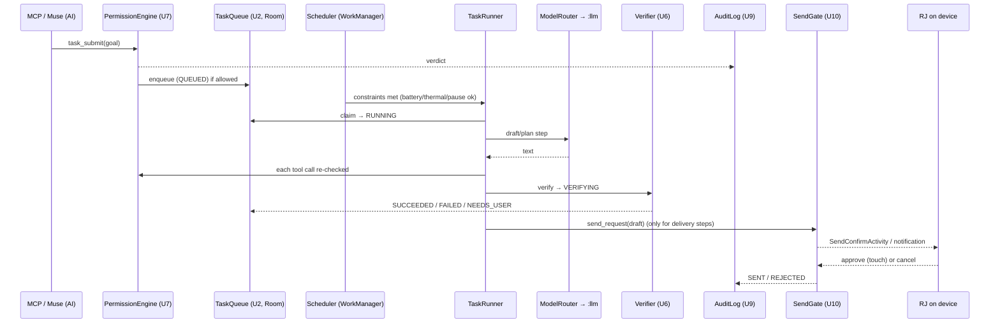
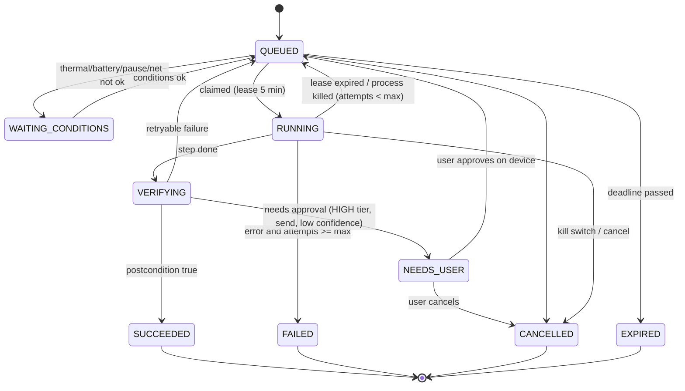

# Broker autonomy upgrades: design for ten upgrades (1.9.x)

Status: design. Branch base: `feature/1.8.8-owndroid-parity` (1.8.8-dev, vc18). Written 2026-10-30.
Companion to `docs/ON_DEVICE_LLM_PLAN.md`, which covers the runtime, models and send gate.

Honesty constraints:
* The broker has **no root**. Its privilege comes from Shizuku (uid 2000), the broker priv server (uid 2000,
  needs a bootstrap after every reboot) and Dhizuku (device owner).
* The broker does no "power harvesting". It cannot run while the phone is off.
* Android can and will kill or defer background work. Everything below is designed to resume, not to be immortal.

Device budget (TC22, measured 2026-10-30):
* about 918 MB free storage;
* about 1.3 GB MemAvailable with about 1.2 GB already swapped;
* 2× A78 and 4× A55 cores;
* CPU at 54–59 °C at idle load.

So every upgrade has a storage cap, a RAM cap and a thermal guard.

---

## 0. Priority order

| # | Upgrade | Priority | One-line rationale |
|---|---|---|---|
| 1 | **Strict tool registry + permission engine** (U7) | P0 | Everything else calls tools. One gate must enforce risk tiers, the denylist and owner_policy tiers before autonomy exists |
| 2 | **Durable task queue** (U2) | P0 | Autonomy without persistence loses work on every lmkd kill, update or reboot |
| 3 | **Audit log + observability dashboard** (U9) | P0 | Nothing autonomous ships unless RJ can see what ran, why, and what was refused |
| 4 | **Model router with offline fallback** (U5) | P1 | The Writing Assistant needs a model: local Qwen2.5-0.5B → SmolLM2-360M → optional hosted model when online |
| 5 | **Update/recovery watchdog** (U8) | P1 | `:llm`, the priv server, Shizuku and the accessibility service fail independently. They need detection and safe restart |
| 6 | **Context manager** (U4) | P1 | A 0.5B model has a 1–2k context. Prompt budgeting decides quality more than the model does |
| 7 | **Local memory with user controls** (U3) | P2 | Useful continuity, but it is personal data. It comes after audit and with view/edit/delete/export/off controls |
| 8 | **Goal decomposition + planner** (U1) | P2 | Turns a goal into queued, gated steps. Only safe once U7 and U2 exist |
| 9 | **Self-evaluation + verification** (U6) | P2 | Checks each step's postcondition and the quality of drafts. Cheap rules first, the LLM judge second |
| 10 | **Approved-message scheduled delivery + task runner** (U10) | P3 | The highest-risk capability, so it comes last. Preview first; the send gate from the LLM plan applies unchanged |

Reasoning: safety and durability come first (1–3), then capability (4–6), then intelligence (7–9), and delivery last (10).

---

## 1. Module boundaries (new Kotlin packages, all under `com.rjkyker.shizukuai.broker`)

```
autonomy/registry/   ToolRegistry, PermissionEngine, ToolSpec            (U7)  ← reuses ActionAllowList, ShellDenylist, OwnerPolicyCatalog
autonomy/queue/      TaskQueue, TaskDao, TaskRunnerWorker, Scheduler      (U2, U10 runner)
autonomy/audit/      AuditLog, AuditDao, ObservabilityPanel               (U9)
llm/                 LocalLlmService(:llm), ILocalLlm.aidl, LlamaEngine(JNI), ModelStore, Preflight, Governor
autonomy/router/     ModelRouter, ModelBackend {Local, Fallback, Hosted}  (U5)
autonomy/watchdog/   Watchdog, HealthProbe                                 (U8)
autonomy/context/    ContextManager, TokenBudget                           (U4)
autonomy/memory/     MemoryStore, MemoryDao, MemoryPanel                   (U3)
autonomy/planner/    Planner, PlanStep                                     (U1)
autonomy/eval/       Verifier, DraftEvaluator                              (U6)
autonomy/delivery/   SendGate, OutboxDao, SendConfirmActivity, ReplyListener (U10)
ui/                  WritingAssistantActivity (new), AutonomyPanelController
```

Rules:
* Only `registry/` may call executors: McpToolExecutor, ActionRouter and OwnerPolicyEngine.
* `llm/` lives in process `:llm` and must not import `bridge/`, `priv/`, `owner/`, `dhizuku/` or `delegation/`. A unit
  test scans the imports to enforce this.
* `delivery/` is the only package allowed to fire a send PendingIntent. MCP can reach it only through `send_request`,
  which only queues.

## 2. Kotlin interfaces (abridged)

```kotlin
// U7
enum class Tier { READ, LOW, MEDIUM, HIGH, LOCKOUT, FORBIDDEN }
enum class Actor { USER_DEVICE, MCP_AI, PLANNER, WATCHDOG, SCHEDULER }
data class ToolSpec(val name: String, val tier: Tier, val needsNetwork: Boolean = false,
                    val shellCommandArg: String? = null, val ownerOpArg: String? = null)
data class Verdict(val allowed: Boolean, val tier: Tier, val reason: String, val needsUserConfirm: Boolean = false)
interface PermissionEngine { fun check(tool: String, args: JSONObject, actor: Actor, confirmed: Boolean): Verdict }

// U2
enum class TaskState { QUEUED, WAITING_CONDITIONS, RUNNING, VERIFYING, NEEDS_USER, SUCCEEDED, FAILED, CANCELLED, EXPIRED }
interface TaskQueue {
  fun enqueue(t: NewTask): Long; fun claimNext(now: Long, conditions: DeviceConditions): TaskEntity?
  fun transition(id: Long, to: TaskState, note: String = ""): Boolean; fun cancel(id: Long): Boolean
}

// U5
interface ModelBackend { val id: String; fun available(): Availability; fun generate(req: GenRequest, cancel: CancelToken): GenResult }
interface ModelRouter { fun route(req: GenRequest): RouteDecision }          // ordered: local-primary, local-fallback, hosted(opt-in)

// U4
interface ContextManager { fun build(goal: String, memory: List<MemoryItem>, history: List<Turn>, budgetTokens: Int): Prompt }

// U3
interface MemoryStore { fun add(m: MemoryItem): Long?; fun list(): List<MemoryItem>; fun update(id: Long, text: String)
                        fun delete(id: Long); fun exportJson(): String; var enabled: Boolean }
// U1 / U6
interface Planner { fun plan(goal: String): List<PlanStep> }    // rule templates first, LLM-assisted later
interface Verifier { fun verify(step: PlanStep, result: JSONObject): Verification }
// U8
interface HealthProbe { val name: String; fun probe(): Health; fun recover(): RecoveryResult? }
// U9
interface AuditLog { fun record(e: AuditEvent); fun recent(limit: Int, filter: AuditFilter? = null): List<AuditEvent> }
// U10
interface SendGate { fun request(draft: OutboundDraft, actor: Actor): SendDecision }   // never SENT when actor != USER_DEVICE
```

## 3. Event flow



## 4. Task lifecycle state machine



Invariants:
* Each transition is written to Room *before* it has side effects. The step's side effect is idempotent (it carries
  an `idempotency_key`), so a re-run after a kill is safe.
* `NEEDS_USER` can leave only through an on-device approval. No MCP path exists.

## 5. Persistent storage (Room, `autonomy.db`, in `noBackupFilesDir`)

| Table | Columns |
|---|---|
| `tasks` | id PK, kind TEXT, goal TEXT, args_json TEXT, state TEXT, priority INT, actor TEXT, attempts INT, max_attempts INT, not_before_ms INT, deadline_ms INT, lease_until_ms INT, idempotency_key TEXT UNIQUE, parent_id INT NULL, created_ms, updated_ms, result_json TEXT NULL, error TEXT NULL |
| `task_events` | id PK, task_id FK, from_state, to_state, note, ts_ms |
| `audit` | id PK, ts_ms, actor, tool, tier, allowed INT, reason, args_hash TEXT (sha256, no bodies), task_id NULL, latency_ms INT NULL |
| `memory` | id PK, kind (fact/preference/contact_note), text, source (user/ai), created_ms, updated_ms, pinned INT, ttl_ms NULL |
| `outbox` | id PK, app_pkg, recipient_key, text, state (DRAFT/PENDING_CONFIRM/SENT/REJECTED/EXPIRED), created_ms, scheduled_ms NULL, decided_ms NULL, approver NULL, reject_reason NULL |
| `send_rules` | id PK, app_pkg, recipient_key, max_len, daily_cap, window_start_min, window_end_min, expires_ms, created_ms (device-created only) |
| `model_runs` | id PK, ts_ms, backend, model_id, prompt_tokens, gen_tokens, prefill_tps REAL, decode_tps REAL, peak_rss_kb INT, thermal INT, outcome |

Caps:
* `audit`: 20k rows, then rotation.
* `task_events`: pruned after 14 days.
* `memory`: 500 items, 4 KB each.
* The whole DB stays under 25 MB, checked against the storage floor.

**Downgrade-safe migrations:**
* Migrations are additive only: add columns or tables; never rename or drop in 1.9.x.
* Every schema version writes `autonomy_export_v<N>.json`, a JSON dump of the user's data (memory, rules, outbox
  drafts), before migrating.
* A newer app can always import an older export.
* `fallbackToDestructiveMigrationOnDowngrade()` is acceptable *only because* that export exists and memory/rules can
  be re-imported.

## 6. Security model
* **One gate:** ToolRegistry/PermissionEngine wraps every tool call from MCP, the planner and the runner.
  * It reuses `ActionAllowList` risk levels, `ShellDenylist` (every route plus the priv server) and
    `OwnerPolicyCatalog.decide` (LOCKOUT/FORBIDDEN never reach the AI).
  * The Shizuku allowlist is **not widened**. New autonomy tools are LOW/MEDIUM and only queue, read or draft.
* **Actor separation:** `MCP_AI` and `PLANNER` can never satisfy `needsUserConfirm`. Only `USER_DEVICE`, from a
  touch inside a non-exported activity, can do that.
* **Kill switch:** `autonomy_enabled` and `send_enabled` (both default OFF in prefs). `broker_pause` stops the
  scheduler. There is also a dashboard "STOP ALL" button.
* **Network:**
  * `:llm` has no network code.
  * The hosted model backend is opt-in, off by default, and requires a URL and key that RJ sets on the device. It
    sends only the built prompt, which is scrubbed of the DiscoveryManifest secrets list.
* **Data:**
  * Room lives in app-private `noBackupFilesDir`.
  * Audit stores hashes, not message bodies.
  * Memory can be exported (JSON via SAF) and fully wiped from the dashboard.

## 7. Android 13 background execution (TC22)
* **FGS:** `BrokerService` already runs `specialUse`. `:llm` LocalLlmService is `specialUse` *only while
  generating* (started from a visible activity, or from the already-foreground BrokerService, which is an allowed
  FGS start). No new FGS is started from the background without an exemption; battery optimization is already off
  for the broker, which permits it.
* **WorkManager:** TaskRunnerWorker uses constraints (battery not low, storage not low) plus a custom thermal and
  pause check inside `doWork`, with exponential backoff. Expedited work is used for user-initiated tasks only.
* **Exact alarms:**
  * Scheduled delivery uses `setExactAndAllowWhileIdle` only if `canScheduleExactAlarms()` returns true.
    `SCHEDULE_EXACT_ALARM` is user-grantable on 13, and the broker does not declare `USE_EXACT_ALARM`.
  * Otherwise it falls back to a WorkManager window of ±10 min.
  * The alarm only **shows the confirm notification**. It never sends by itself unless a device-created standing
    rule covers it.
* **Doze:** the battery-optimization exemption helps, but maintenance windows still apply. Timing is best-effort and
  reported honestly in the UI.
* **Boot:** BootReceiver re-arms the scheduler and watchdog. The priv server still needs a Shizuku or ADB
  bootstrap (no root).

## 8. Per-upgrade notes
* **U7 Registry.** `ToolSpec` is generated from `McpToolExecutor.toolDefinitions()` plus `ActionAllowList`. Unknown
  tool means FORBIDDEN. Tiers map as: RiskLevel LOW→LOW, MEDIUM→MEDIUM, HIGH→HIGH (confirm), plus owner_policy
  LOCKOUT/FORBIDDEN passthrough.
* **U2 Queue.** Room plus a lease. The claim is a single UPDATE … WHERE state=QUEUED with a lease. max_attempts
  defaults to 3, and backoff is 30 s·2^n.
* **U9 Audit.** Every PermissionEngine verdict, task transition, model run and send decision is recorded. The
  dashboard shows the last 50, counts by outcome, and model tokens/s. MCP gets `autonomy_audit` (read-only).
* **U5 Router.** Order: `local:qwen2.5-0.5b-q4km` → `local:smollm2-360m-q40` → `hosted` (opt-in, needs network).
  It skips any backend whose preflight fails: RAM (900 MB / 450 MB), storage, thermal or pause.
* **U8 Watchdog.** Probes run every 15 min via WorkManager, plus on boot: `:llm` binder ping, priv-server ping,
  Shizuku binder, accessibility connected, MCP `/health` on loopback. Recovery is limited to safe actions: rebind,
  `priv_service start` via Shizuku, a notification asking RJ to re-enable a11y. It never reinstalls or uninstalls.
  After an update it compares versionCode and offers a one-tap "export → revert flag".
* **U4 Context.** Token budget = n_ctx − max_new − 64. Fill order: system prompt → pinned memory → task goal →
  recent turns (newest first). Truncation is per item.
* **U3 Memory.** Off by default. User controls: view, edit, delete, export, wipe, and an off switch. AI-proposed
  memories are stored only when they come from `USER_DEVICE` or after user acceptance.
* **U1 Planner.** Deterministic templates (e.g. "draft reply" → [gather context, draft, evaluate, send_request]).
  LLM-assisted decomposition stays behind a flag. Every step re-enters PermissionEngine.
* **U6 Verifier.** Rule checks (length, forbidden content, postcondition probes such as "package now hidden") and an
  optional LLM self-critique score. Low confidence leads to NEEDS_USER.
* **U10 Delivery.** Exactly the LLM-plan send gate: kill switch OFF by default, empty app and recipient allowlists,
  per-message on-device approval (or a device-created narrow standing rule), rate limits, audit. Paths are the
  notification `RemoteInput` reply or an `ACTION_SEND` compose screen only. Never shell, `am start` SMS/dialer, or
  SmsManager. MCP/AI can never approve.

## 9. Phased release plan

| Version | Ships | Acceptance tests (must pass) |
|---|---|---|
| **1.9.0** | U7 PermissionEngine, U2 Room queue, U9 audit + dashboard panel, `llm/` (`:llm` service, AIDL, ModelStore sha256, Preflight, Governor, llama.cpp JNI CPU), U5 router, U3 memory (off by default), U4 context, U1 template planner, U6 rule verifier, U8 watchdog probes, U10 preview-only outbox (kill switch OFF, allowlists empty) | JVM: registry denies LOCKOUT/FORBIDDEN for MCP/PLANNER; unknown tool = FORBIDDEN; queue transitions are legal-only, lease expiry requeues, idempotency is unique; router skips a backend that fails preflight; context never exceeds budget; memory export/delete round-trips; SendGate never returns SENT for MCP/PLANNER, kill switch blocks; `llm` package has no forbidden imports. Device: health, a11y, Dhizuku, shell routes, priv server OK; one local generation recorded in `model_runs` |
| 1.9.1 | NotificationListener reply path + SendConfirmActivity (FLAG_SECURE, obscured-touch reject), rate limits, standing rules (device-only) | Instrumented: an obscured tap is rejected; a11y gesture into the confirm window is refused; rate limit is enforced; a rule expires |
| 1.9.2 | Exact-alarm scheduled delivery (confirm notification), WorkManager fallback | Alarm denied → WorkManager window; Doze test with `cmd deviceidle force-idle` via Shizuku on a test phone only |
| 1.9.3 | LLM-assisted planner + self-critique, hosted backend (opt-in) | Planner output validated against the registry; hosted backend off by default; scrubber removes secrets |
| 1.9.4 | OpenCL experimental flavor, Qwen2.5-1.5B upgrade tier | Benchmark gate from the LLM plan §9 |

## 10. Rollback strategy
* **No `pm install -d` and no uninstall, ever.** Downgrades are not possible with `install -r`, so rollback means
  **roll-forward**: ship vc N+1 built from the previous good source with a higher versionCode.
* **Feature flags** (`AutonomyFlags` in SecurePrefs, read on every entry point): `autonomy_enabled`, `llm_enabled`,
  `planner_enabled`, `memory_enabled`, `send_enabled`, `hosted_enabled`. Dashboard "STOP ALL" sets them all off,
  and MCP `broker_pause` sets autonomy off. Flags default OFF in 1.9.0, except the `llm_enabled` draft path, which is
  user-initiated.
* **DB:** additive migrations, an export before each migration, and import on roll-forward.
* **Model:** deleting the model file from the dashboard frees the storage. The model lives in app-private storage,
  so nothing of RJ's is touched.
